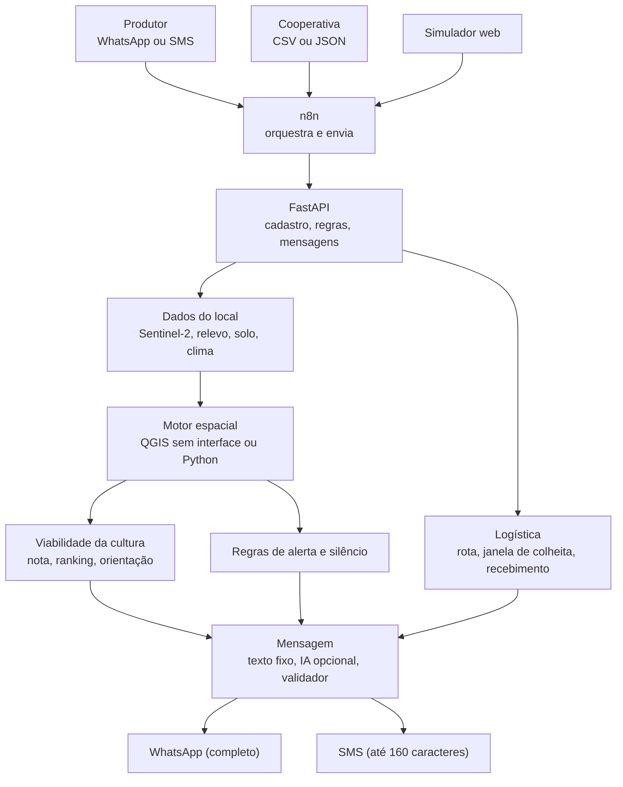

# BALK-HackBrasil

> **Technology should not be a privilege.** BALK makes precision agriculture accessible to small and medium farmers, turning satellite, weather, and field data into clear, timely agronomic and logistics recommendations to reduce losses, improve productivity, and maximize profits.

**Em português:** a tecnologia não deve ser um privilégio. O BALK leva agricultura de precisão ao pequeno e ao médio produtor. Ele transforma dados de satélite, clima e campo em recomendações agronômicas e logísticas claras e na hora certa, para reduzir perdas, aumentar a produtividade e melhorar o lucro.

Pelo WhatsApp ou por SMS em celular simples, o produtor recebe avisos curtos sobre o próprio terreno: quando pulverizar, quando vem geada, qual cultura combina com a área e a melhor hora para colher e levar a safra. Sem app e sem equipamento. A cooperativa também ganha, porque sabe quanto vai receber em cada dia e se organiza com antecedência.

## O problema

- No Brasil, só **19,9%** dos estabelecimentos rurais recebem assistência técnica (Embrapa, Censo Agropecuário 2017).
- Cerca de **72%** não tinham acesso à internet na propriedade (Censo Agropecuário 2017, divulgado pelo G1). O próximo censo está previsto para 2027.
- Mesmo assim, o produtor decide plantio, pulverização e colheita sem dados do próprio terreno.

## Demonstração

**Vídeo (até 3 minutos):** <colar o link público do vídeo>

A demonstração usa dados de exemplo e de 3 áreas verdes públicas, sem nenhum dado pessoal real.

## O que o BALK faz

1. **Cadastro** por WhatsApp, por SMS (`BALK soja 20/10 Sorriso MT`) ou por arquivo CSV de uma cooperativa.
2. **Análise espacial do local em menos de 1 minuto:** NDVI, declividade, argila e clima, calculados com o QGIS sem interface (`qgis_process`) ou com o motor Python equivalente.
3. **Viabilidade da cultura:** nota de 0 a 100, as 3 culturas mais indicadas, o fator limitante e uma frase de orientação.
4. **Alertas:** pulverização, geada, estresse da lavoura e colheita e escoamento, com nível de confiança e política de silêncio (poucos avisos, só quando há decisão a tomar).
5. **Logística:** melhor horário de saída da colheita com menos chuva na rota, frete estimado e previsão de recebimento da cooperativa por dia.
6. **Redação da mensagem:** texto fixo por tipo de alerta; uma IA simples pode reescrever, mas um validador em código reprova qualquer número inventado e, nesse caso, vale o texto fixo.

### O que é real e o que é simulado na demonstração

Atualizem esta tabela antes de enviar.

| Funcionalidade | Estado na demo |
| --- | --- |
| Cadastro pelo simulador web | <real / simulado> |
| Cadastro por CSV de cooperativa | <real / simulado> |
| Imagens Sentinel-2 e NDVI | <real, com cache / simulado> |
| Motor QGIS (`qgis_process`) | <real / só motor Python> |
| Clima (Open-Meteo) | <real / cache> |
| Alertas de pulverização e geada | <real / simulado> |
| Logística (rota e previsão de recebimento) | <real / simulado> |
| SMS | <provedor real / simulador na tela> |
| WhatsApp | <Cloud API de teste / simulador> |
| Redação com IA | <ativa / desligada> |

## Como funciona



O sistema separa **cálculo, decisão e comunicação**. As regras decidem se há alerta, a gravidade e a confiança. A IA, quando usada, apenas reescreve uma decisão já tomada e nunca decide se algo deve ser pulverizado, irrigado ou colhido.

## O que o produtor recebe

**WhatsApp:**

> Adie a pulverização de amanhã para quinta, das 6h às 9h. Amanhã há 80% de chance de chuva às 14h e vento acima de 15 km/h.
>
> Por quê: a chuva lava o produto. Confiança: média-alta (previsão de 24 horas).

**SMS (sem acentos, até 160 caracteres):**

> BALK: GEADA amanha 4h-7h, min 2C. Proteja culturas sensiveis. Resp 1=ok 2=ajuda

Os exemplos acima são ilustrativos, não previsões reais.

**Níveis de confiança:** `alta`, `media` e `baixa`. Sem dado suficiente, o sistema diz que não há dado suficiente em vez de apresentar um palpite como fato.

## Como rodar

Requisitos: Git, Python 3.12 e (opcional, para o n8n e o QGIS) Docker com Docker Compose.

```bash
git clone https://github.com/<usuario>/<repositorio>.git && cd <repositorio>
python -m venv .venv && source .venv/bin/activate && pip install -r requirements.txt
cp .env.example .env   # a demo funciona sem chaves, com dados em cache
uvicorn app.main:app --reload
pytest
```

Depois, abra `http://localhost:8000/demo` para o simulador de WhatsApp e SMS e `http://localhost:8000/docs` para a API.

Para subir também o n8n e o QGIS: `docker compose up`.

No Windows (PowerShell), ative o ambiente com `.venv\Scripts\Activate.ps1` e copie o arquivo com `Copy-Item .env.example .env`.

## Variáveis de ambiente

Nunca coloquem chaves no repositório. O `.env.example` traz só os nomes.

| Variável | Para que serve | Obrigatória |
| --- | --- | --- |
| `ENGINE` | `qgis` ou `python` (motor espacial) | Não (padrão `python`) |
| `WHATSAPP_ACCESS_TOKEN`, `WHATSAPP_PHONE_NUMBER_ID`, `WHATSAPP_VERIFY_TOKEN` | WhatsApp Cloud API | Só com WhatsApp real |
| `SMS_ACCOUNT`, `SMS_TOKEN`, `SMS_FROM` | Provedor de SMS | Só com SMS real |
| `LLM_API_KEY` | Redação com IA | Opcional |

Confirmem os nomes finais com o `.env.example` do repositório.

## Fontes de dados

**Usadas no MVP**

| Dado | Fonte | Uso |
| --- | --- | --- |
| Imagens de satélite | Sentinel-2 L2A via Earth Search (STAC) | NDVI |
| Relevo | Copernicus DEM GLO-30 | Declividade |
| Solo | SoilGrids (arquivos GeoTIFF) | Argila |
| Clima | Open-Meteo (previsão e histórico) | Alertas e viabilidade |
| Faixas por cultura | FAO EcoCrop | Nota de viabilidade |
| Rotas | OSRM (servidor de demonstração) | Logística |
| Mensagens | WhatsApp Cloud API e provedor de SMS | Entrega |

**Planejadas:** INMET, ERA5-Land, CHIRPS, NASA POWER, MapBiomas, ESA WorldCover e WorldCereal, ZARC, IBGE SIDRA (produtividade por município), Fields of The World (limites de talhão) e GEMS (calendário agrícola).

Disponibilidade, resolução, licença e uso comercial variam por fonte. Por exemplo, o plano gratuito do Open-Meteo é só para uso não comercial. Um dado disponível não torna a recomendação confiável por si só.

## Limites e aviso de uso

- O BALK é um apoio à decisão. **Não substitui um engenheiro agrônomo** e não indica produto nem dose.
- Os limiares das regras partem de referências públicas (FAO, Embrapa), ficam em `rules.yaml` e `crops.yaml` com a fonte de cada valor e **ainda não foram validados por agrônomos em campo**.
- A análise é feita sob demanda a partir de imagens de 10 m que passam a cada poucos dias. Não é monitoramento em tempo real. Talhões pequenos (aproximadamente menores que 7 ha) têm margem de erro maior e a confiança é reduzida.
- O projeto está em desenvolvimento e não está pronto para uso em produção.

## Privacidade (LGPD)

O produtor aceita receber mensagens no primeiro contato, pode sair respondendo `SAIR` e o registro do consentimento é guardado. A demonstração usa apenas dados sintéticos e áreas públicas.

## Estrutura do repositório

```text
app/
  main.py        # rotas da API
  models.py      # contratos de dados compartilhados
  ingest/        # cadastro, conversa, CSV
  data/          # dados do local (satélite, clima, solo)
  engine/        # motor espacial: QGIS e Python
  viability/     # nota, ranking e orientação
  alerts/        # regras e silêncio
  message/       # modelos fixos, IA, SMS
  logistics/     # rota, colheita e previsão de recebimento
  demo/          # simulador web e dados de exemplo
n8n/             # fluxos exportados
tests/
rules.yaml
crops.yaml
```

## Roadmap

- [ ] Núcleo do MVP: cadastro, viabilidade com mapa, alertas de clima, SMS e logística
- [ ] Redação com IA e validador
- [ ] WhatsApp Cloud API em produção
- [ ] Revisão dos limiares com agrônomos e backtest com dados históricos
- [ ] Piloto com uma cooperativa
- [ ] Áudio (voz sintética e transcrição)
- [ ] Limites de talhão (Fields of The World) e histórico por talhão
- [ ] Expansão para outros países da América Latina

## Equipe

Time de 4 pessoas no Hack Brasil 2026.

- <nome> (<github>)
- <nome> (<github>)
- <nome> (<github>)
- <nome> (<github>)

## Licença

[MIT](./LICENSE)

## Agradecimentos

Embrapa, FAO, Programa Copernicus (Sentinel), NASA, ISRIC (SoilGrids), Open-Meteo, MapBiomas e as comunidades de código aberto de geoprocessamento.
